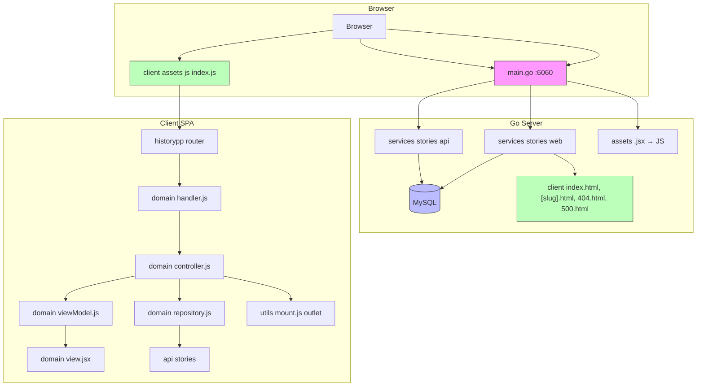
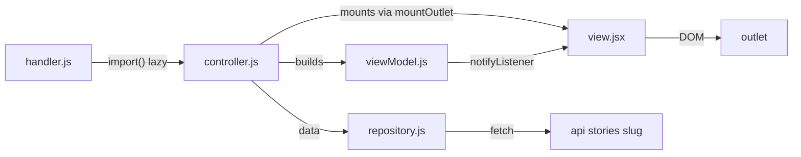
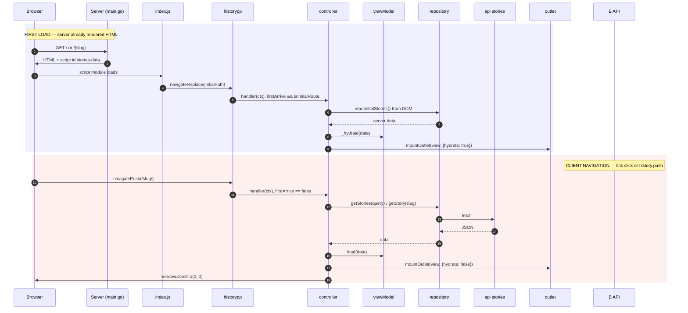

# vull-stack

A small Go application that renders pages on the server and then takes over as a
single page application in the browser: server-side rendering for the first
paint, client-side routing for every navigation after it.

No bundler, no build step, no `node_modules`. The Go binary is the only build
artifact; `.jsx` files are compiled on demand while the assets are served.

## Features

- **SSR first.** `/`, `/{slug}` and the 404 page are rendered with
  `html/template` from MySQL, so the first paint is complete HTML.
- **SPA after hydration.** The same HTML is reused as the initial state; later
  navigations are handled in the browser by `historypp` and never hit the
  document.
- **JSX without a build step.** `internal/jsxtranspiler` compiles `.jsx` on the
  fly when the asset is requested and serves it as plain JavaScript.
- **MVVM per domain.** Each route owns a
  `handler → controller → viewModel → view` chain plus a `repository` for data
  access. The controller only decides what to render; mounting into `#outlet`
  (hydrate vs replace) is handled by `utils/mount.js`.
- **Scroll to top on navigation.** Every client-side route change resets the
  window scroll to `y = 0`.
- **Route transition indicator.** A reference-counted loading indicator is
  mounted once into `#portal` and driven by the router.
- **Search.** Server-side filtering through `?q=`, plus live client-side
  filtering over the stories already loaded for the route.
- **Page metadata.** The document title and the meta description follow the
  active route, on the server and on the client.

## Tech stack

| Layer | Choice |
| --- | --- |
| Language | Go 1.25 |
| HTTP | `net/http` (`ServeMux` patterns, `CrossOriginProtection`) |
| Database | MySQL (`go-sql-driver/mysql`) |
| Config | `.env` via `joho/godotenv` |
| Templates | `html/template` |
| Client router | [`historypp`](client/assets/js/libs/historypp) |
| Client DOM/JSX runtime | [`dompp`](client/assets/js/libs/dompp) |
| Tests | `go test` |

`historypp` and `dompp` are git submodules, so they are versioned separately
from this repository and must not be edited here.

## Architecture



The web and API layers are separate on purpose: `services/stories/web` returns
HTML, `services/stories/api` returns JSON, and both share the same table and the
same `handler → usecase → repository` shape.

### MVVM layer per route (client)



Each domain folder (`stories`, `story`, `not-found`) holds its own `handler`,
`controller`, `repository`, `viewModel`, and `view` so nothing leaks across
routes.

### Sequence: first load vs client navigation



## Project structure

```
main.go                       asset serving, wiring, HTTP server
internal/jsxtranspiler/       JSX → JS compiler used at request time
services/stories/web/         HTML use case (list, show, not found, server error)
services/stories/api/         JSON use case (list, show)
services/admin/               content management domain (backoffice, placeholder)
database/schema.sql           table definition
database/seed.sql             sample rows
client/index.html             list template (SSR)
client/[slug].html            detail template (SSR)
client/404.html               not found template (SSR)
client/500.html               server error template (SSR)
client/assets/js/index.js     router bootstrap
client/assets/js/domain/      one folder per route: handler, controller,
                              repository, viewModel, view
client/assets/js/components/  reusable UI (loading indicator)
client/assets/js/utils/       shared helpers (meta, paths, mount)
client/assets/css/            styles
client/assets/js/libs/        dompp, historypp (submodules)
```

## Getting started

Requirements: Go 1.25+ and a reachable MySQL server.

```bash
cp .env.example .env
```

Create the schema and load the sample data:

```bash
mysql -u root -p < database/schema.sql
mysql -u root -p vss < database/seed.sql
```

Run the server:

```bash
go run .
```

Then open <http://127.0.0.1:6060>.

On Windows with WDAC or Smart App Control enabled, `go run` can be blocked by
policy. Build the binary and run it directly instead:

```powershell
go build -o main.exe .
.\main.exe
```

## Configuration

| Variable | Default | Description |
| --- | --- | --- |
| `DB_HOST` | `127.0.0.1` | MySQL host |
| `DB_PORT` | `3306` | MySQL port |
| `DB_USER` | `root` | MySQL user |
| `DB_PASS` | empty | MySQL password |
| `DB_NAME` | `vss` | Database name |
| `APP_PORT` | `6060` | HTTP port |

`.env` is gitignored; `.env.example` is the template.

## Routes

| Method | Path | Type | Description |
| --- | --- | --- | --- |
| `GET` | `/` | HTML | Story list, optional `?q=` filter |
| `GET` | `/{slug}` | HTML | Story detail, 404 page for an unknown slug |
| `GET` | `/api/stories` | JSON | Story list, optional `?q=` filter |
| `GET` | `/api/stories/{slug}` | JSON | Story detail, 404 for an unknown slug |
| `GET` | `/assets/...` | static | CSS, images, plain JS |
| `GET` | `/assets/**/*.jsx` | JS | `.jsx` compiled on the fly |
| `GET` | `/favicon.ico` | 404 | Not served |
| any | anything else | HTML | 404 page |

API responses are wrapped: `{"data": ...}`.

## How the SPA layer works

**Bootstrap.** `client/assets/js/index.js` registers the routes, then replays the
current URL with `history.navigateReplace(...)`. The first run is flagged
`firstArrive && isInitialRoute`, which tells every layer that the server already
rendered this page.

**SSR handoff.** The server embeds the data it used for the render in a
`<script type="application/json">` block (`#stories-data` on the list,
`#story-data` on the detail). On the initial route the repository reads that
block instead of calling the API, so the first paint costs no extra request. The
404 page carries no data and always goes through the API-free path.

**Mounting.** `#outlet` is the view container and is replaced on client-side
navigation. `#portal` lives outside it, so the loading indicator survives a route
change. Mounting (hydrate vs replace) is centralized in `utils/mount.js` so no
controller repeats the `if/else`.

**View state.** `viewModel` is the only mutable state; `view.jsx` subscribes
through `addListener` and each `document.createComponent` slice re-renders on its
own notification.

**Metadata.** `utils/meta.js` exposes `setPageMeta(title, description)`. Each
controller calls it so a client-side navigation cannot leave the previous page's
title or description behind; the story controller derives both from
`viewModel.story`.

**Loading.** `components/loading` owns a singleton viewModel rendered into
`#portal`. `withLoading(handler)` wraps every route handler, shows the indicator
before the handler runs and hides it when the handler settles. Show/hide are
reference counted so overlapping navigations do not hide each other's spinner.
The initial server-rendered route is skipped, because there is no transition to
indicate.

**Scroll.** Every client-side navigation calls `window.scrollTo(0, 0)` inside
`withLoading`, so each new route starts at the top of the page.

**JSX pipeline.** A request for `/assets/**/*.jsx` is read from disk, compiled by
`internal/jsxtranspiler` and returned as `application/javascript` with
`Cache-Control: no-store`. Everything else under `/assets/` is served as a
static file (also `no-store` so a refactor never leaves stale modules in the
browser cache).

The factory comes from `main.go`:

```go
jsxtranspiler.CompileWithFactory(src, jsxtranspiler.Factory{
	JSX:     "document.createElement",
	JSXFrag: "document.createDocumentFragment",
})
```

`Compile(src)` works too, and then the factory is taken from a pragma in the
source, falling back to `document.createElement` /
`document.createDocumentFragment`. Supported pragmas:

| Pragma | Effect |
| --- | --- |
| `@jsx <factory>` | Element factory, dotted paths allowed |
| `@jsxFrag <factory>` | Fragment factory |
| `@jsxRuntime <mode>` | Parsed and stripped, no behaviour change |

## Tests

```bash
go test ./...
```

The transpiler is the only unit-tested package today
(`internal/jsxtranspiler`): factories, pragmas, comments inside opening tags and
comments at the top level.

## Notes

- The transpiler is a development convenience: it runs on every request for a
  `.jsx` file and intentionally sends `Cache-Control: no-store`.
- `client/assets/js/factories/elementBuilder.js` and the `bindLinkNavigation`
  helper are currently unused; the runtime builder comes from `dompp`.
- The 404 page is rendered by `services/stories/web` for unknown paths, and an
  unknown story slug produces the same page with status 404. Server failures on
  the web layer render `client/500.html` with status 500.

## License

[MIT](LICENSE)